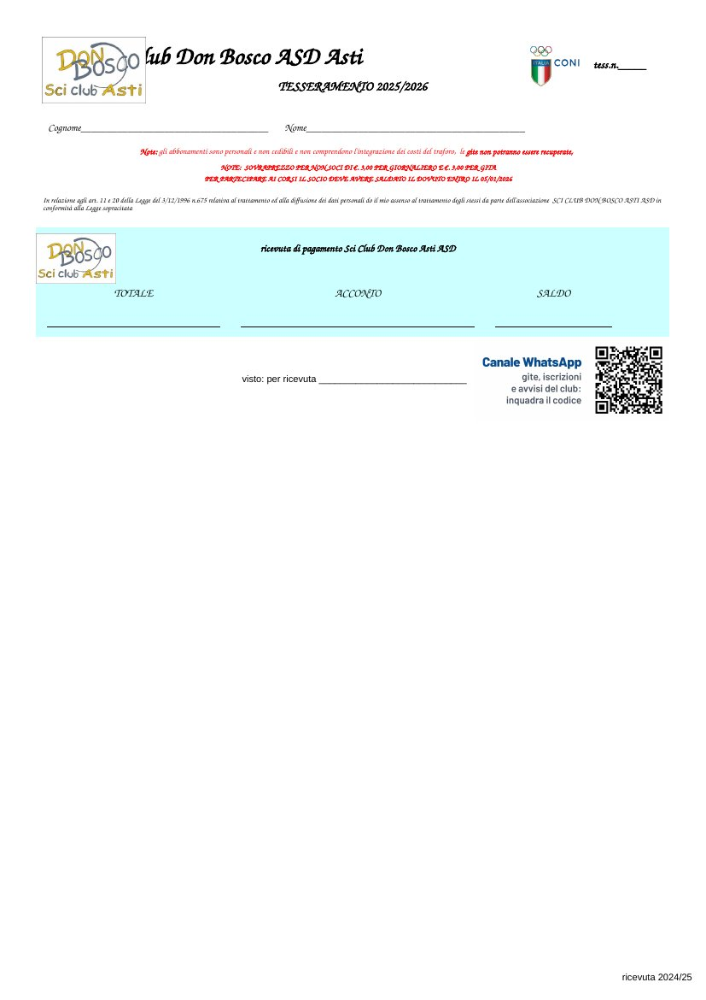
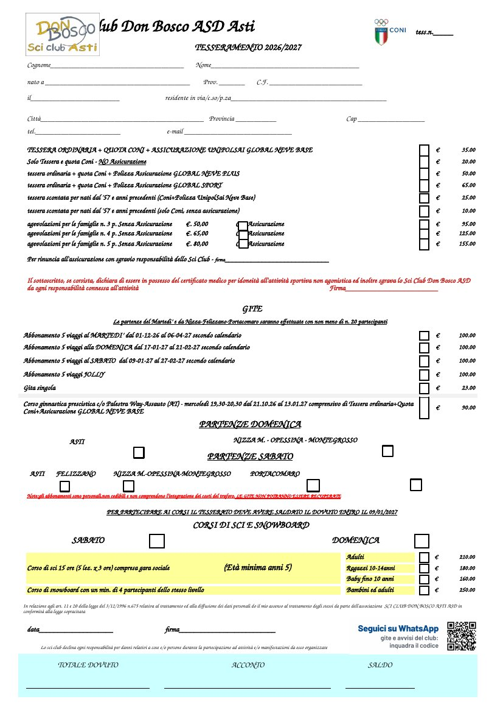

# Canale WhatsApp · cartello e QR nel tesseramento

Il QR porta al canale: https://whatsapp.com/channel/0029Vb98yLKIt5s3Y7pk0V2C
(provato con un lettore di QR su tutti i file, anche rimpicciolito come una
foto fatta col telefono).

## Cartello per il negozio

`cartello-canale-whatsapp.pdf` (A4, da stampare a grandezza naturale, senza
"adatta alla pagina"); anteprima `cartello-canale-whatsapp.jpg`.

QR di 98 mm nero su bianco, il colore più leggibile; verde WhatsApp solo nella
cornice (come scritta sul bianco non si leggerebbe). Sotto, i tre passi e
l'indirizzo per chi non riesce a inquadrarlo.

## QR nella scheda e nella ricevuta del tesseramento

Il file modificato sta accanto all'originale, fuori da git come tutto
`dati26/`: `1TESSERAMENTO Scheda e Ricevuta con QR.xlsx` (e il suo PDF).
L'originale non è toccato.

 

Modifiche minime:

- **Ricevuta** (quella che il socio si porta a casa): la riga di "visto: per
  ricevuta" è più alta e a destra c'è il QR con "Canale WhatsApp" (QR di
  24 mm in stampa). L'area di stampa non cambia: il regolamento sotto resta
  fuori come prima.
- **Scheda**: l'avvertenza "Lo sci-club declina..." occupa le colonne B-H
  invece di B-M, e la riga vuota sotto passa da 6,75 a 12 punti; a destra di
  "data / firma" c'è il QR con "Seguici su WhatsApp" (15 mm in stampa,
  leggibile da vicino). La pagina resta una.

Il PDF qui è fatto con LibreOffice e i caratteri corsivi del modulo possono
venire un po' diversi: per stampare, aprire l'xlsx in Excel come sempre.

Per metterlo altrove: `qr-canale-whatsapp.png` (QR per stampe grandi) e
`qr-canale-whatsapp-piccolo.png` (moduli più grossi, per stampe piccole);
le due etichette col testo sono `etichetta-scheda.png` ed
`etichetta-ricevuta.png`.

## Sorgenti

In `sorgenti/`: `cartello.html` ed `etichetta.html` (`#scheda`, `#ricevuta`),
`rendi.sh` che rifà PDF, anteprima ed etichette con Chrome, e
`metti-qr.py` che mette le etichette nel file del tesseramento lavorando
sull'XML (openpyxl perderebbe i quadratini disegnati della scheda):

    ./rendi.sh
    python3 metti-qr.py "../../../dati26/1TESSERAMENTO Scheda e Ricevuta.xlsx" "uscita.xlsx"
