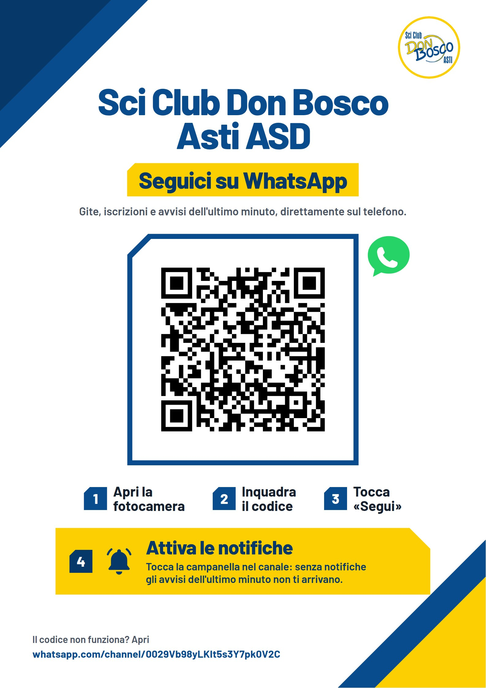

# Canale WhatsApp · cartello per il negozio

Il QR porta al canale: https://whatsapp.com/channel/0029Vb98yLKIt5s3Y7pk0V2C
(provato con un lettore di QR su tutti i file, anche rimpicciolito come una
foto fatta col telefono).

## Cartello per il negozio

Due versioni, stesso cartello, A4 da stampare a grandezza naturale (senza
"adatta alla pagina"): **chiara** `cartello-canale-whatsapp.pdf`, con poco
inchiostro, e **scura** `cartello-canale-whatsapp-scuro.pdf`; anteprime nei
`.jpg` con lo stesso nome.

 

Nello stile di K · Piani, la grafica dei post (14/10), su fondo bianco: le
fasce a 45° della K sugli angoli della pagina (blu scuro e blu in alto a
sinistra, giallo e blu in basso a destra), con ogni diagonale da un bordo
all'altro e lontana da scritte e riquadri. Al centro, grande, **Sci Club Don
Bosco Asti ASD**, sotto «Seguici su WhatsApp» in un riquadro giallo con
l'angolo tagliato, poi il QR di 86 mm nero su bianco, il colore più leggibile,
in una cornice blu con l'angolo tagliato (il fumetto verde appena fuori, per
non interromperla); il logo ufficiale tondo in alto a destra, così com'è (bianco e blu, anello giallo). Sotto, i passi per seguire il
canale e, in giallo, il quarto: **attivare le notifiche** con la campanella,
perché i canali arrivano senza e gli avvisi dell'ultimo minuto non si
vedrebbero. In basso a sinistra l'indirizzo per chi non riesce a inquadrare il
codice.

La **scura** è lo stesso cartello su fondo blu scuro: scritte bianche, numeri
dei passi nei quadrati gialli, la scheda del QR tutta bianca, il triangolo
interno in alto a sinistra in blu notte e il logo tondo uguale alla chiara. Le
stampanti da ufficio lasciano una cornice bianca di qualche millimetro.

## Story per Instagram e Facebook

`story-canale-whatsapp.jpg` (1080×1920), nello stile K dei post (angolo giallo col logo
ufficiale blu): «Il nostro canale
WhatsApp», perché seguirlo, la freccia gialla **TOCCA QUI** che punta al riquadro blu col
bordo giallo, sotto «Poi premi Segui e attiva le notifiche» e la strada senza link
(WhatsApp › Aggiornamenti). Foto: pista a La Thuile di DimiTalen, Wikimedia Commons, CC0.

Il riquadro è **vuoto apposta**: un link scritto nell'immagine non si tocca, si apre solo
lo **sticker link**, che si mette con l'app quando si pubblica. Su Instagram:

1. nuova storia, scegli `story-canale-whatsapp.jpg`;
2. in alto l'icona degli sticker, poi **Link**;
3. incolla `https://whatsapp.com/channel/0029Vb98yLKIt5s3Y7pk0V2C`, e in «Personalizza il
   testo dello sticker» scrivi `CANALE WHATSAPP`;
4. trascina lo sticker dentro il riquadro blu e allargalo con due dita; toccandolo cambia
   colore (il bianco si legge meglio sul blu).

Su Facebook la storia della pagina del club ha lo stesso sticker Link: da verificare
la prima volta che si pubblica.

## Il QR da solo

Per metterlo altrove (il volantino con il QR lo usa già): `qr-canale-whatsapp.png` (QR per stampe grandi) e
`qr-canale-whatsapp-piccolo.png` (moduli più grossi, per stampe piccole).

## Sorgenti

In `sorgenti/`: `cartello.html` (la scura è `cartello.html#scuro`), `story.html`, i QR in SVG
e `rendi.sh`, che rifà con Chrome PDF e anteprime del cartello e il JPEG della story (il carattere Barlow è in `../font/barlow/`).
