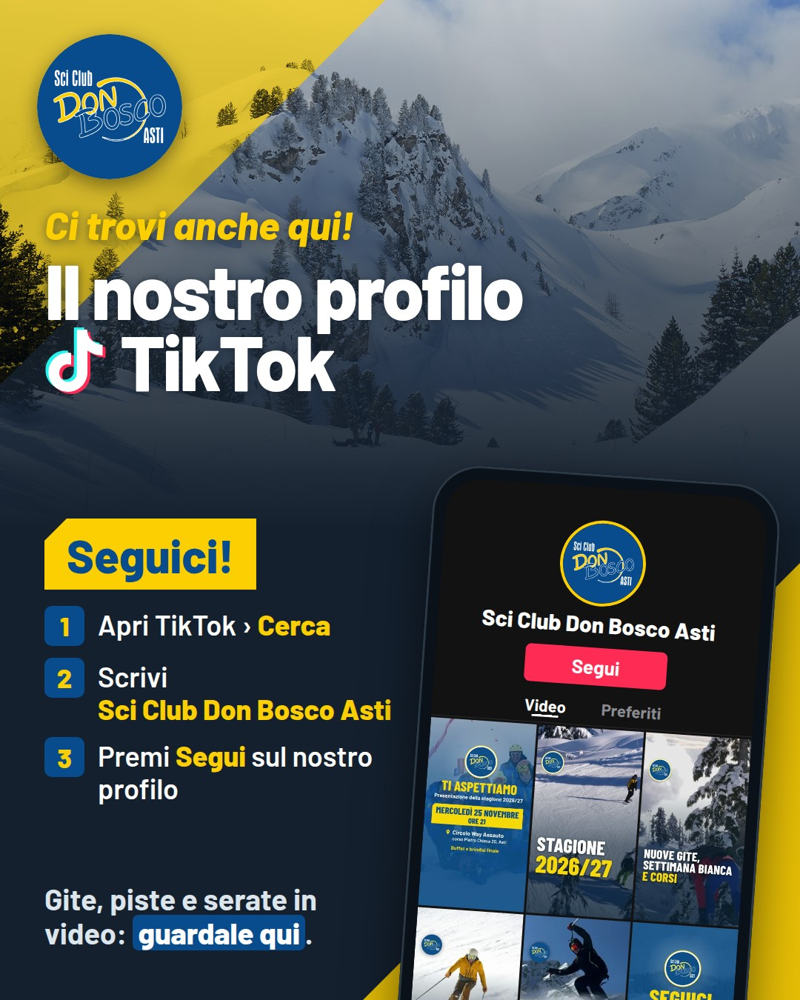

# Profilo TikTok · post per Instagram e Facebook

`post-profilo-tiktok.jpg` (1080×1350, va bene nel feed di entrambi) annuncia il profilo TikTok del club,
aperto a novembre 2026. È una copia del post del canale WhatsApp (`../canale-whatsapp/`), nello stile K
dei post: angolo giallo col logo, «Ci trovi anche qui!», «Il nostro profilo TikTok» col logo di TikTok,
un telefono con il profilo del club e i fotogrammi dei nostri video, e a sinistra i tre passi per trovarlo.



Il nome utente del profilo, `@sciculbdonboscoasti`, ha un refuso («sciculb» invece di «sciclub») e TikTok
permette di cambiarlo solo dal 15 dicembre 2026. Per questo il post fa cercare il nome del club, che è
scritto giusto, e non mostra la @; il link sta nel testo del post. Quando il nome utente sarà corretto,
va aggiornato il link della didascalia (il post non cambia).

## Didascalia

```
Ci trovi anche su TikTok! 🎬❄️

Gite, piste, corsi e serate del club, in video brevi: segui il profilo dello Sci Club Don Bosco Asti per non perderti niente della stagione 2026/27.

👉 Apri TikTok, cerca «Sci Club Don Bosco Asti» e premi Segui
🔗 https://www.tiktok.com/@sciculbdonboscoasti

#sciclubdonbosco #asti #sci #snowboard #tiktok #stagione2026
```

Su Instagram il link nel testo non si tocca: va anche nella storia, con lo sticker Link.

## Sorgenti

In `sorgenti/`: `post.html`, i fotogrammi dei video del club in `fotogrammi/` (estratti da
`../video-serata-post/renders/invito-serata-post-16s.mp4` e `../video-stagione/renders/story-stagione-16s.mp4`)
e `rendi.sh`, che rifà il JPEG con Chrome. Foto di sfondo: pista a La Thuile di DimiTalen, Wikimedia
Commons, CC0. Logo TikTok: Simple Icons. Prova in `../lancio-stagione/sorgenti/prova.js` («post del
profilo TikTok»).
