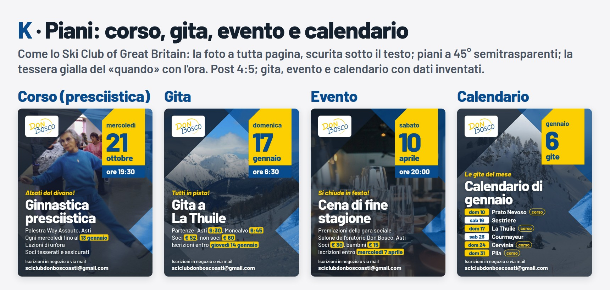
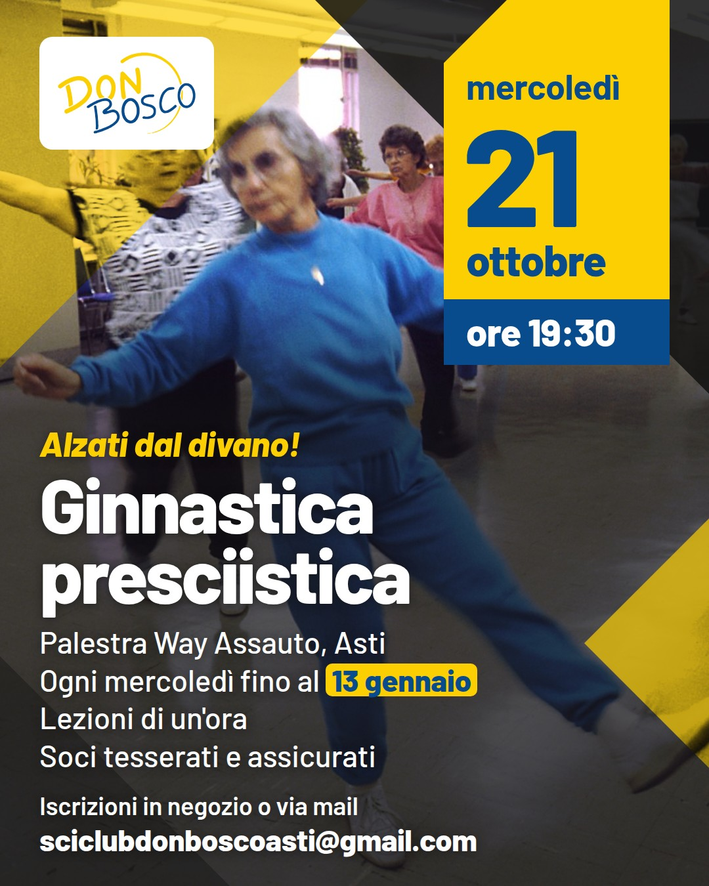
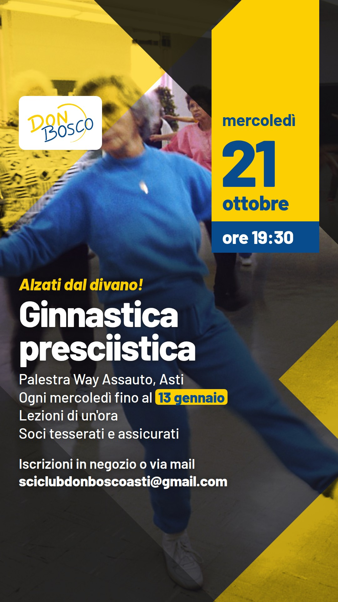

# Grafica dei post social: K · Piani

**K · Piani** è la grafica ufficiale di tutti i post del club su Instagram e Facebook (dal
15/10/2026 l'unica: le altre proposte e le grafiche Ritocco, Montagna, Biglietto, Calendario e
Divano sono state tolte, restano nella storia di git). Nel sito la disegna
`web/social-templates.js` (`postK`, `meseK`), che è il riferimento vero: qui c'è il disegno
d'origine, su quattro post: il corso (la ginnastica presciistica, da cui è partito tutto),
una gita, un evento (una cena) e il calendario del mese.

Cambiato nel generatore dopo queste tavole (15/10): il velo sotto il testo tende al blu scuro
del club (`--velo`, 0,72–0,82) invece del blu notte, le righe dei dati e le iscrizioni del post
sono più grandi. Dal 16/10 il logo è quello ufficiale blu, tondo, sempre sull'angolo giallo
(anche nei post blu), e il velo sotto il testo è blu notte, perché i riquadri blu delle partenze
si stacchino.

## Regole fisse

- Un solo blu `#084C8D` e un solo giallo `#FCCF02` (quelli del logo), più il bianco e il testo
  scuro `#14202E`; carattere Barlow.
- Testo grande: almeno 34 px nel post e 44 px nella story (su 1080).
- Story: niente di importante nei 250 px in alto e nei 300 px in basso, dove Instagram mette
  il profilo e la risposta.
- **Regola per dividere immagine e testo.** L'immagine gira da sola (WhatsApp,
schermate, inoltri): in tutte e tre c'è tutto quello che serve per andarci e
iscriversi (le informazioni di A). Il testo del post aggiunge l'invito,
l'istruttore dello scorso anno e la pausa di Natale. La mail va sempre anche
nel testo, perché dal testo si può copiare e da un'immagine no.

## Com'è fatta

 

Richiesta del 12/10: proposte dai post dello Ski Club of Great Britain. Dei tre abbozzi (K · Piani, L · Pendio, M · Album) è stata scelta K e
sviluppata come chiesto: più rilievo a ora e giorno, piani semitrasparenti per far vedere le
immagini, niente omino al centro; poi meno blu, col testo direttamente sulla foto scurita. Post
4:5 e story del corso; usa solo Barlow.

- La **foto a tutta pagina**, scurita dal blu notte (il colore del testo, `#14202E`) sempre di
  più verso il basso: in alto resta viva, sotto il testo sta senza fondo, con un'ombra morbida.
  Dal 14/10 il velo è un po' più leggero ("forse è un po' scura"): 0,66-0,76 sotto il testo,
  fra lo 0,72-0,8 di prima e lo 0,55-0,65 provato e scartato perché si leggeva poco. Contrasto
  del testo bianco sul fondo più chiaro dietro di lui, misurato sui post resi: corso 9,9, gita
  8,2, evento 6,8, calendario 7,4, story del corso 10,3 (minimo 4,5).
- **Gite: la meta grande.** «Gita a» in piccolo sopra e la meta in grande (Barlow nero 150,
  fino a 860 px di larghezza), alto quanto il titolo su due righe degli altri post: i dati
  partono dallo stesso punto. Nel generatore la meta va presa a parte dal titolo.
- Sopra, **quattro piani a 45° appoggiati ai bordi**, come i loro "Snow Show London" e "WIN!":
  il blu col logo in alto a sinistra, il cuneo blu notte dietro la tessera in alto a destra (dal
  14/10, come nel giallo e nero: prima erano al contrario), la finestra a destra, l'ombra in basso
  a sinistra.
- **Semitrasparenze per le immagini.** Il blu e il cuneo blu notte lasciano vedere la foto. Nella
  **finestra** la foto, allineata, torna in bianco e nero tinta di blu
  (`background-blend-mode: color`): lì può andare anche un'altra immagine (la variabile
  `--immagine` sul `.cv`; nel calendario, per prova, c'è La Thuile sopra la montagna). Nella
  story una seconda finestra riempie la fascia coperta in fondo.
- **Due colori, dal colore del post** (`coloreNuovo` nel generatore): corsi e gite
  di domenica in **giallo e nero**, evento, calendario e il resto in **blu e nero**. Nel giallo
  e nero (classe `giallo` sul `.cv`, richiesta del 13/10) i piani scuri sono in nero neutro
  (`--notte`), il cuneo dietro la tessera resta scuro, l'angolo in alto a sinistra e la finestra
  a destra sono gialli e semitrasparenti (`--velo-giallo`, 0,7): la foto in grigi schiariti col
  giallo in multiply, così il nero resta nero e il bianco diventa giallo, e sotto si vede ancora
  la foto vera. Tessera, fascia dell'ora e riquadrini restano blu. Il giallo steso a velo sulla
  foto a colori non va: col cielo blu e i grigi medi diventa verde oliva.
- La **tessera gialla del "quando"**, appesa al bordo alto con l'angolo tagliato (come il
  riquadro giallo del loro "WIN!"): giorno della settimana, numero enorme (Barlow nero 210),
  mese e, nella **fascia blu, l'ora** in bianco (`ore 19:30`; nella gita la prima partenza).
- Sulla foto scurita, da un punto fisso: il **gancio** in giallo corsivo, il **titolo bianco in
  minuscolo** (Barlow nero 116, sempre alto due righe), poi i dati in righe brevi (46), con
  **orari, prezzi e scadenze nei riquadrini gialli**.
- Il **logo** nel riquadro bianco sul blu notte; le iscrizioni con la mail in fondo, in bianco.
- **Il corso ha la foto**, al posto del disegno: per prova una foto di pubblico dominio di un
  corso di ginnastica (Bill Branson, National Cancer Institute, 1988, da Wikimedia Commons).
  Con le foto del corso dell'anno scorso verrebbe meglio.
- **Calendario:** sei righe non stanno sotto il titolo se parte all'altezza degli altri post,
  quindi lì titolo e righe partono più in alto (`--fine: 470px`, e il velo scuro con loro). La tessera, senza ora,
  conta le gite del mese; il giorno nel colore della gita (domenica gialla, sabato bianca), il
  corso in un'etichetta contornata.
- **Da tenere d'occhio:** le righe dei dati non devono arrivare alla finestra (la punta è a
  890 px): le più lunghe vanno dopo la prima riga, o si accorciano. Il velo sotto il testo deve
  restare scuro abbastanza anche con foto chiare (neve al sole). Le foto orizzontali, a tutta
  pagina, vengono ingrandite quasi del doppio: meglio foto grandi o verticali. Senza foto il
  fondo è da decidere. Una seconda immagine nella finestra, nel generatore, vorrebbe un secondo
  caricamento.

## Sorgenti

In `sorgenti/` una pagina HTML per tipo (`corso-k.html`, `gita-k.html`, `evento-k.html`,
`calendario-k.html`; `#post` o `#story` nell'indirizzo sceglie il formato, la story c'è solo per
il corso), i fogli comuni (`comune.css`, `comune.js`, `k.css`), le foto d'esempio in `foto/`
(anche la story del canale WhatsApp usa `calendario-montagna.jpg`) e `tavola.html#k`.
`Mail per Presciistica.docx` è la mail da cui vengono i testi del corso.

`./rendi.sh` rifà tutti i JPEG con Chrome (il carattere Barlow è in `../font/barlow/`, così non
dipende dalla rete); `./rendi.sh verifica` controlla corpi minimi, fasce coperte della story e
testo tagliato.
