# Proposte di grafica per i post social

Tre grafiche da scegliere per tutti i post del club su Instagram e Facebook:
**A · Biglietto**, **B · Calendario**, **C · Divano**. Dalla 2.8 sono nel
generatore dei post (Social > Impostazioni > Grafica dei post: `biglietto`,
`calendario`, `divano` in `web/social-templates.js`), accanto a Ritocco e
Montagna; queste pagine restano il riferimento del disegno. Ogni tavola mostra una
proposta su quattro post: il corso (la ginnastica presciistica, da cui è
partito tutto), una gita, un evento (una cena) e il calendario del mese.

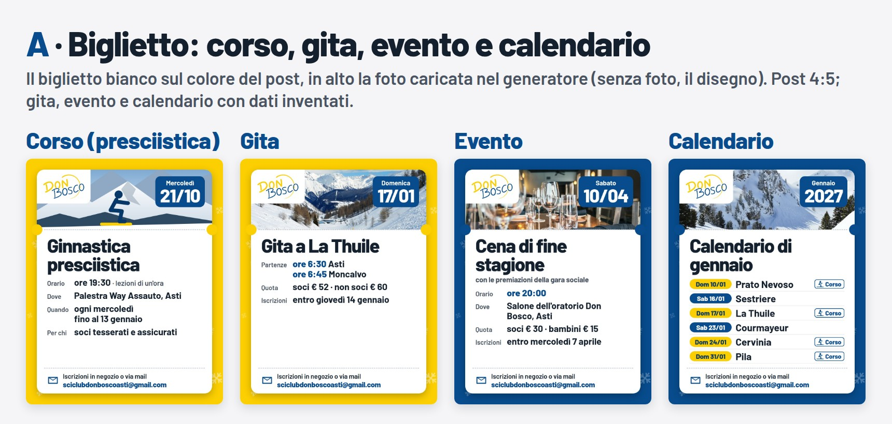

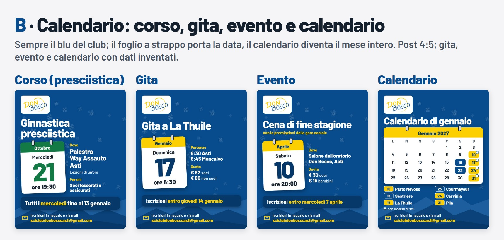

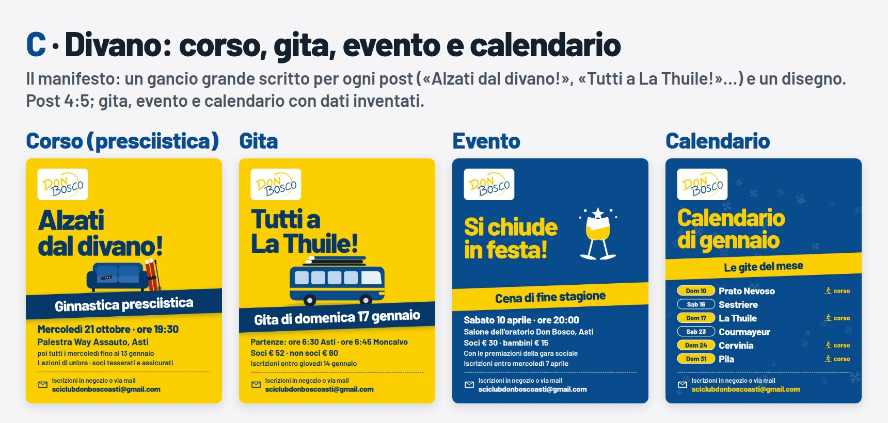

Dall'11/10 ci sono anche due proposte di stile, ispirate ai marchi dello sci, solo come
tavole (non ancora nel generatore): **D · Pista** (stile da gara, alla Head, tutto dritto) ed
**E · Fascia** (stile classico, alla Rossignol). Stessi colori, stessi testi; vedi
"Le proposte di stile" in fondo.

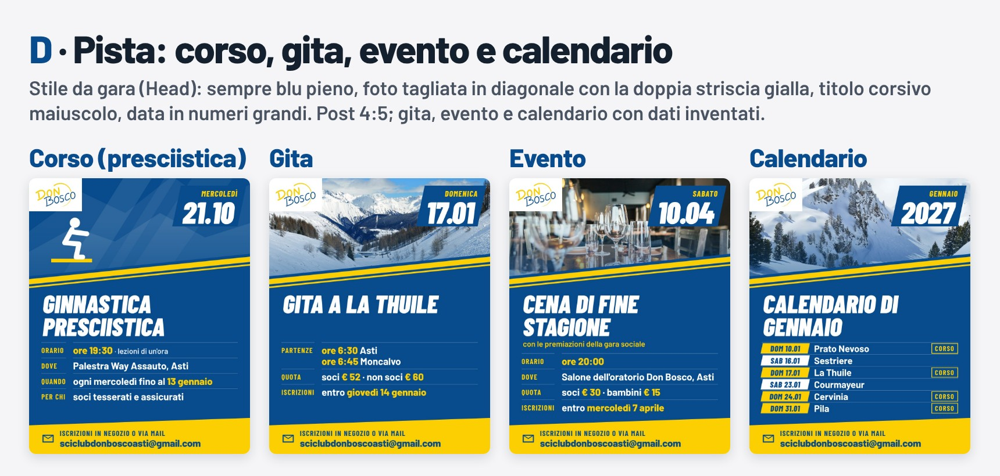

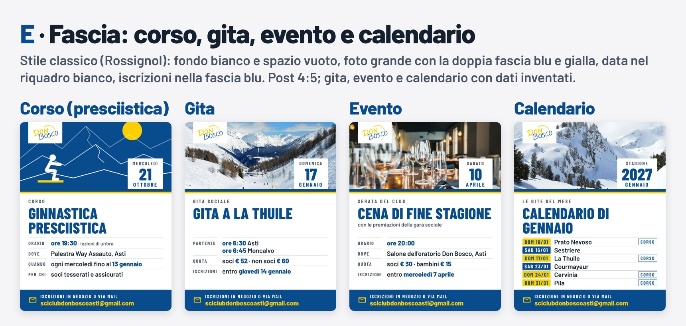

E una terza, **F · Diagonale**, ispirata ai post dello Ski Club of Great Britain.

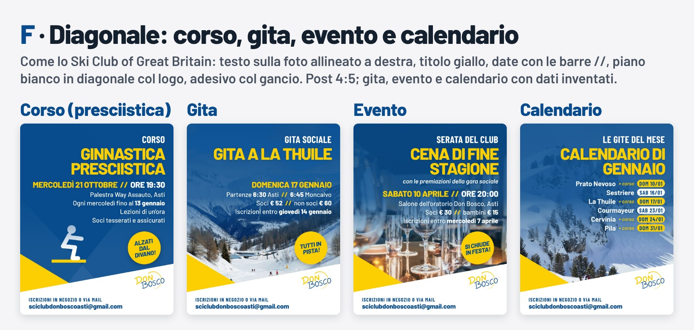

Poi tre idee più moderne e "da gara", con la foto a tutto schermo un po' scurita, le
scritte sopra e i dati in blocchi pieni dei colori del club: **G · Cronometro**,
**H · Eco**, **I · Bento** (vedi "Le idee da gara" in fondo).

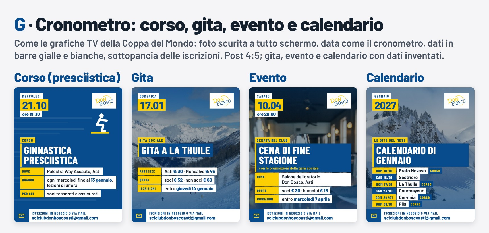

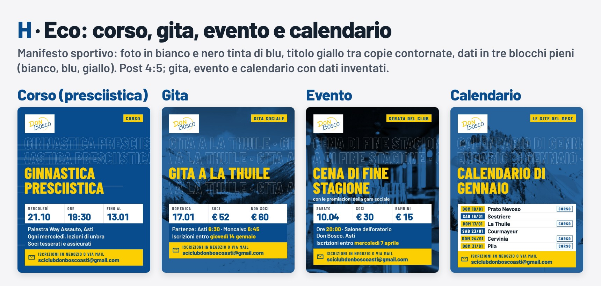

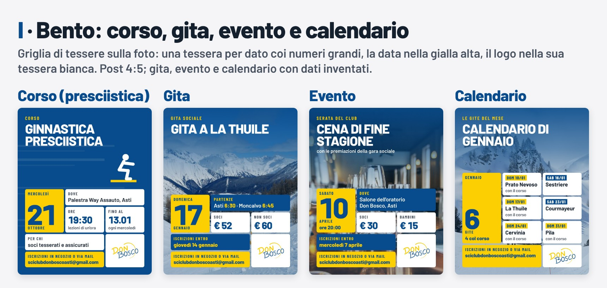

| Cartella | Cosa |
|---|---|
| `tavola-a.jpg`, `-b`, `-c` | le tre proposte, una tavola ciascuna |
| `post/` | i post uno per uno: `corso-a.jpg`, `gita-b.jpg`, `evento-c.jpg`, `calendario-a.jpg`...; il corso anche in story (`corso-a-story.jpg`) e la panoramica del corso (`corso-panoramica.jpg`) |
| `Mail per Presciistica.docx` | la mail da cui vengono i testi del corso |
| `sorgenti/` | le pagine HTML e lo script che rifà le immagini |

Tutti i post sono 4:5 (1080×1350, come Montagna); gita, evento e calendario
hanno dati inventati.

- **Il testo non si sposta:** in ogni proposta titolo, fascia e testo partono
  sempre dallo stesso punto, in tutti i post; un testo più lungo scende più in
  basso. Il titolo occupa sempre due righe anche quando ne basta una (in A
  più la riga del sottotitolo, anche vuota), così i dati sotto partono alla
  stessa altezza. In A la foto (o il disegno) in alto è alta uguale per tutti; in C
  gancio e disegno hanno altezza fissa, così la fascia centrale sta sempre lì
  (tranne nel calendario, che non ha disegno). `./sorgenti/rendi.sh verifica`
  stampa le coordinate per controllarlo.
- **B senza la griglia del mese:** nel calendario le gite sono righe dentro il
  foglio, perché la griglia dei giorni ripeteva le stesse date.
- **I dettagli importanti si vedono subito:** orari, prezzi e scadenze in blu
  in A, in giallo in B, evidenziati in C. Nella gita di B il foglio non porta
  l'ora (contano le partenze, accanto) ma resta lungo come gli altri.
- **Per ora solo giallo e blu** (niente rosso del martedì né arancio delle
  cene): gita di domenica in giallo, evento e calendario in blu; nel
  calendario c'è un sabato al posto della gita del martedì.
- **A e C prendono il colore del post**, **B è sempre blu** e il colore sta
  nella testata del foglio.
- In ogni post della stessa tavola le informazioni sono quelle che servono a
  quel post; la proposta cambia solo come sono disegnate.
- **Giallo dei corsi e domeniche:** sono lo stesso giallo. Nel calendario il
  corso è un'etichetta contornata, non piena, per non confondersi.
- **C** è "Divano" per la presciistica. In alto il nome ("Ginnastica
  presciistica", "Gita a La Thuile"), nella fascia la data, sotto il gancio
  ("Alzati dal divano!", "Tutti in pista!", "Si chiude in festa!") e i dati, in
  un riquadro bianco uguale sul giallo e sul blu, con le iscrizioni in fondo: si
  capisce subito cos'è e quando. Il gancio va scritto post per post: è la
  grafica che chiede più lavoro a chi pubblica. Sullo sfondo fiocchi e
  montagne stilizzate in bianco trasparente (più opachi sul giallo, dove il
  bianco si vede meno).
- **Titoli che dicono cos'è:** "Gita a La Thuile", non solo il posto;
  "Calendario di gennaio" per il calendario del mese.
- **A con la foto:** in alto la foto caricata nel generatore (gita, cena,
  calendario); senza foto resta il disegno, come nel corso. Foto d'esempio da
  Wikimedia Commons, libere (CC0): pista San Bernardo e Ponteilles a La Thuile
  di DimiTalen, la tavola apparecchiata da Unsplash.

## Regole fisse

**Colori, in tutte le proposte:** un solo blu `#084C8D` e un solo giallo
`#FCCF02` (quelli del logo), più il bianco e il testo scuro `#14202E`. Niente
blu più scuri o più chiari: le sfumature (montagne di B, cuscini del divano)
sono bianco trasparente sul blu; i riquadri in evidenza sono gialli.

**Misure, uguali in tutti i post della stessa proposta (px su 1080):**

| | A · Biglietto | B · Calendario | C · Divano |
|---|---|---|---|
| Titolo | 104, sempre alto 2 righe (+ sottotitolo 40) | 104, sempre alto 2 righe | nome 150 su 2 righe; fascia con la data 72 |
| Dati | etichette 36, valori 50 | etichette 38, valori 56, note 40 | gancio 58 ("Alzati dal divano!"), righe 46, note 40 |
| In evidenza | orari, prezzi, scadenze in blu | orari e prezzi in giallo; riquadro giallo 54 | sotto la fascia un riquadro bianco uguale in tutti i post, testo blu; orari, prezzi e scadenze in un riquadrino blu con la scritta gialla |
| Iscrizioni | 40 / 46, nel biglietto | 40 / 48, in un riquadro bianco | 40 / 48, in fondo al riquadro bianco, dopo un filo |

Nel foglio di B mese 46, giorno 48, numero 250 e ora 58: il foglio è lungo
uguale anche quando l'ora non c'è (la gita).

---

## Il post del corso (presciistica)

Testi presi dalla mail, con post e story per ogni proposta.

**Rivisto il 10/10** dopo il primo giro: A sul giallo, che diventa il colore
di tutti i corsi; B senza "Torna il corso di", senza la linea del tempo e la
pausa di Natale, con la frase "Tutti i mercoledì fino al 13 gennaio"; logo
più grande in tutte e tre (150 px invece di 96–100). Poi B e C con le stesse
informazioni di A: titolo, mercoledì 21 ottobre, ore 19:30 e lezioni di
un'ora, Palestra Way Assauto ad Asti, ogni mercoledì fino al 13 gennaio, soci
tesserati e assicurati, iscrizioni in negozio o via mail con l'indirizzo.

- Testi presi dalla mail `Mail per Presciistica.docx`, niente di aggiunto:
  niente prezzo, niente nome dell'istruttore, niente telefoni.
- Testo grande: almeno 34 px nel post e 44 px nella story.
- Story: niente di importante nei 250 px in alto e nei 340 px in basso,
  dove Instagram mette il profilo e la risposta.

**Regola per dividere immagine e testo.** L'immagine gira da sola (WhatsApp,
schermate, inoltri): in tutte e tre c'è tutto quello che serve per andarci e
iscriversi (le informazioni di A). Il testo del post aggiunge l'invito,
l'istruttore dello scorso anno e la pausa di Natale. La mail va sempre anche
nel testo, perché dal testo si può copiare e da un'immagine no.

### A · Biglietto

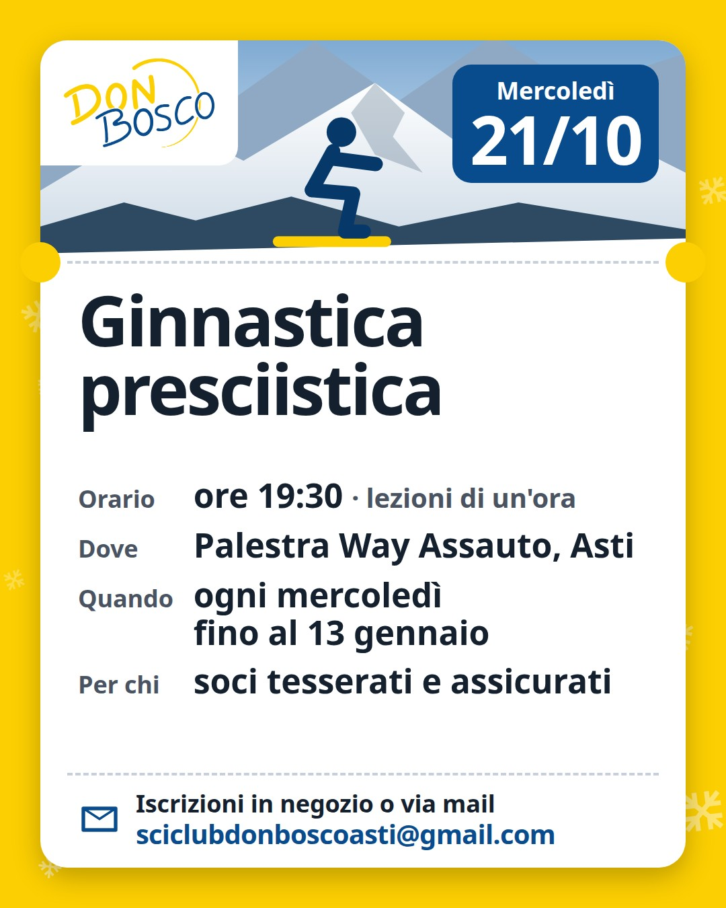 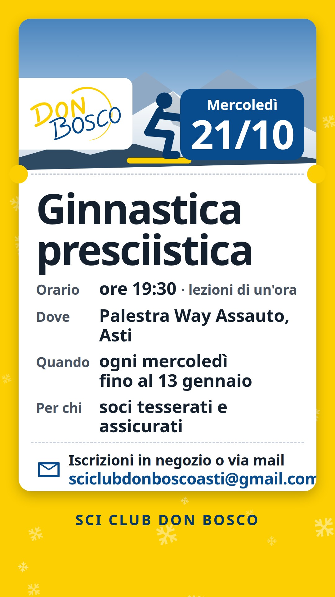

**Idea.** È Ritocco portato al 4:5: il biglietto bianco sul giallo dei corsi,
con il bollo blu della data in alto. Il giallo vale per tutti i corsi (in
Genera post andrebbe cambiato il colore della categoria corso), e sul giallo
gli accenti sono il blu del club. Al posto della foto, il paesaggio disegnato
con una figura in posizione da sci. È la più vicina a quello che c'è già e
può diventare il modello "corso" di Genera post.

**Nell'immagine:** tutto. Titolo, primo giorno, orario e durata, palestra,
ogni mercoledì fino al 13 gennaio, per chi, iscrizioni e mail.

**Nel testo:** l'invito, l'istruttore dello scorso anno, le stesse
informazioni scritte per esteso.

**Perché:** è il biglietto completo, come quelli delle gite: chi lo riceve
inoltrato ha tutto quello che serve. È la più fitta delle tre.

```text
Alzati dal divano: è ora di prepararsi alla prossima stagione sci! ⛷️

Mercoledì 21 ottobre 2026 alle 19:30 riparte il corso
di ginnastica presciistica, nella palestra della Way Assauto di Asti.
Lezioni di un'ora con l'istruttore dello scorso anno,
tutti i mercoledì fino al 13 gennaio 2027 (escluso il periodo di Natale).

Il corso è riservato ai soci tesserati e assicurati
con lo Sci Club Don Bosco Asti.
Iscrizioni come sempre in negozio o via mail:
sciclubdonboscoasti@gmail.com

Vi aspettiamo numerosi!
#sciclubdonbosco #presciistica #sci
```

---

### B · Calendario

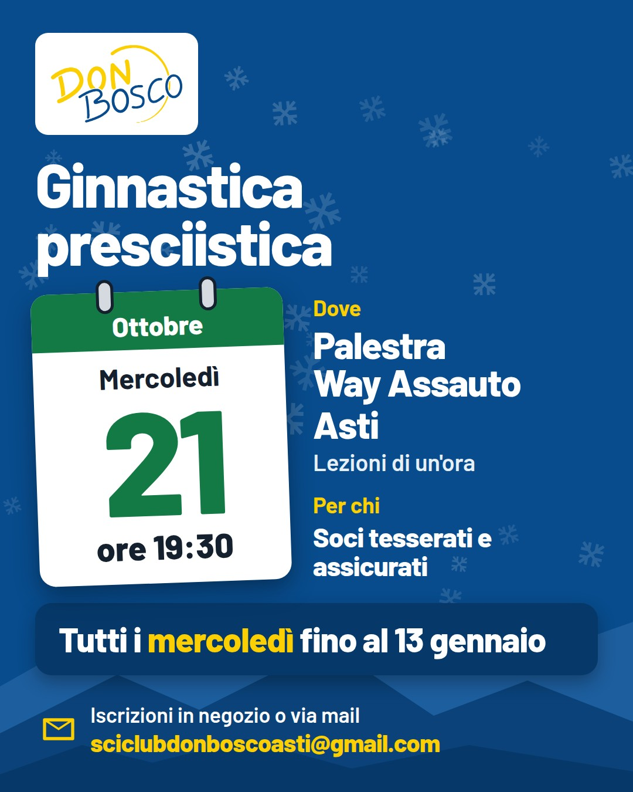 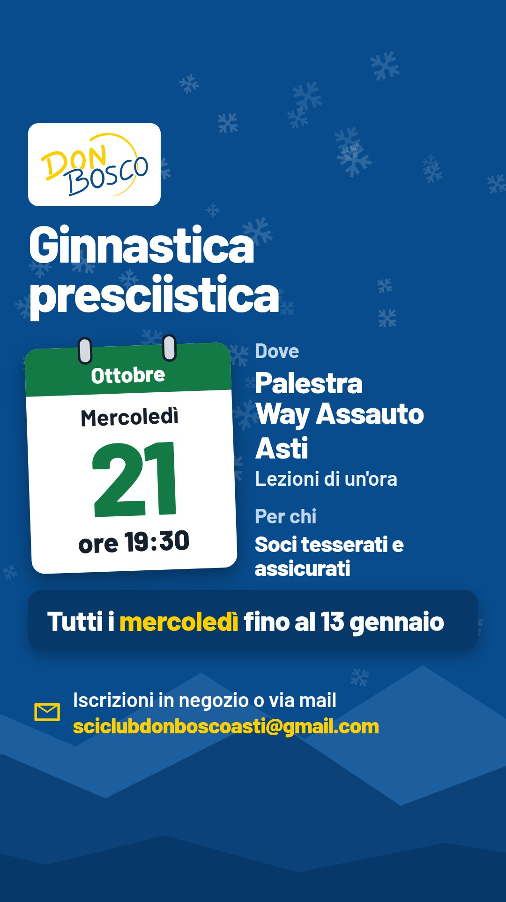

**Idea.** Il messaggio è la data. Un foglio di calendario con il 21 ottobre
e sotto una frase sola: "Tutti i mercoledì fino al 13 gennaio".
Fondo blu del club con neve e montagne, come Montagna.

**Nell'immagine:** le stesse informazioni di A. Il foglio porta giorno e ora;
accanto palestra, lezioni di un'ora e per chi (soci tesserati e assicurati);
sotto "Tutti i mercoledì fino al 13 gennaio" e le iscrizioni con la mail.

**Nel testo:** l'invito, l'istruttore dello scorso anno, la pausa di Natale.

**Perché:** chi salva l'immagine come promemoria vede subito giorno, ora e
fino a quando dura, e ha comunque tutto per iscriversi.

```text
📅 Segnatevi il mercoledì: dal 21 ottobre torna la ginnastica presciistica!

Ci vediamo alle 19:30 nella palestra della Way Assauto di Asti,
poi tutti i mercoledì fino al 13 gennaio 2027 (escluso il periodo di Natale).
Un'ora di preparazione mirata allo sci, con l'istruttore dello scorso anno.

👉 Riservato ai soci tesserati e assicurati con lo Sci Club Don Bosco Asti.
✍️ Iscrizioni come sempre in negozio o via mail:
sciclubdonboscoasti@gmail.com

#sciclubdonbosco #presciistica #sci
```

---

### C · Divano

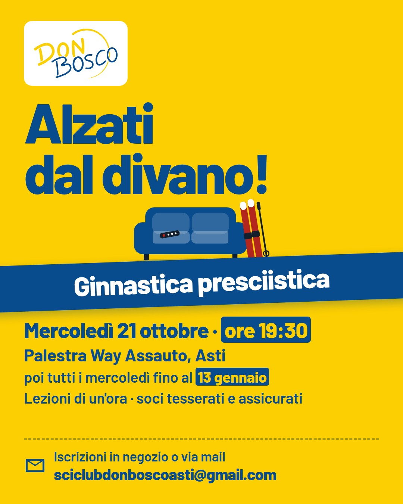 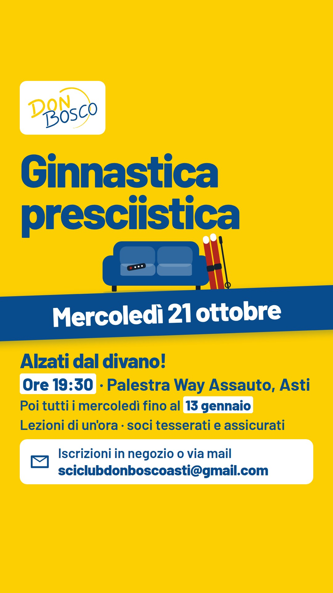

**Idea.** Un manifesto. La prima riga della mail, «Alzati dal divano!»,
diventa il titolo, enorme, sul giallo del logo; sotto, un divano vuoto con
il telecomando lasciato lì e gli sci appoggiati. È la più diversa dai post
di sempre e quella che si nota di più scorrendo.

**Nell'immagine:** il titolo «Alzati dal divano!», il nome del corso e sotto
le stesse informazioni di A: primo appuntamento (giorno, ora, palestra), poi
tutti i mercoledì fino al 13 gennaio, lezioni di un'ora, soci tesserati e
assicurati, iscrizioni in negozio o via mail con l'indirizzo. Il divano si è
rimpicciolito per fare posto.

**Nel testo:** l'invito, l'istruttore dello scorso anno, la pausa di Natale.

**Perché:** il titolo grande si nota scorrendo, le informazioni sotto bastano
per iscriversi. Sul giallo si scrive solo blu scuro e il logo sta su bianco,
come chiedono le regole del marchio.

```text
Alzati dal divano: la prossima stagione sci si prepara adesso! 🛋️⛷️

Corso di ginnastica presciistica
📅 Si comincia mercoledì 21 ottobre 2026 alle 19:30
📍 Palestra della Way Assauto, Asti
🔁 Tutti i mercoledì fino al 13 gennaio 2027, escluso il periodo di Natale
⏱️ Lezioni di un'ora con l'istruttore dello scorso anno

Riservato ai soci tesserati e assicurati con lo Sci Club Don Bosco Asti.
Iscrizioni come sempre in negozio o via mail:
sciclubdonboscoasti@gmail.com

Vi aspettiamo numerosi!
#sciclubdonbosco #presciistica #sci
```

---

## Sorgenti

In `sorgenti/` una pagina HTML per tipo e proposta (`corso-a.html`,
`gita-b.html`...; `#post` o `#story` nell'indirizzo sceglie il formato, la
story c'è solo per il corso), i fogli comuni (`comune.css`, `comune.js`, e
`a.css`, `b.css`, `c.css` per gita, evento e calendario), le foto d'esempio
in `foto/`, `panoramica.html` e `tavola.html#a`, `#b`, `#c`.

`./rendi.sh` rifà tutti i JPEG con Chrome (il carattere Barlow è in
`../font/barlow/`, così non dipende dalla rete); `./rendi.sh verifica` controlla corpi minimi, fasce coperte della
story e testo tagliato.

---

## Le proposte di stile (D, E ed F)

Richiesta dell'11/10: un redesign con i colori del club ma con lo stile dei marchi
famosi dello sci. Solo l'ispirazione: niente loghi, galletti o strisce riconoscibili
dei marchi veri. Stessi testi e stesse foto di A, B e C, stesse misure (post 4:5 e
story del corso), stessi controlli di `rendi.sh verifica` (corpi minimi, fasce della
story). Le righe in maiuscolo stretto sono in **Barlow Condensed** (stessa famiglia di
Barlow, licenza OFL, pesi 700 e 800), in locale in `grafica/font/barlow-condensed/`:
nel generatore sarebbe un font in più.
Il maiuscolo stretto è solo per titoli, date ed etichette; i dati restano in Barlow
dritto, minuscolo e grande, per chi legge con vista debole.

### D · Pista (stile da gara, alla Head)

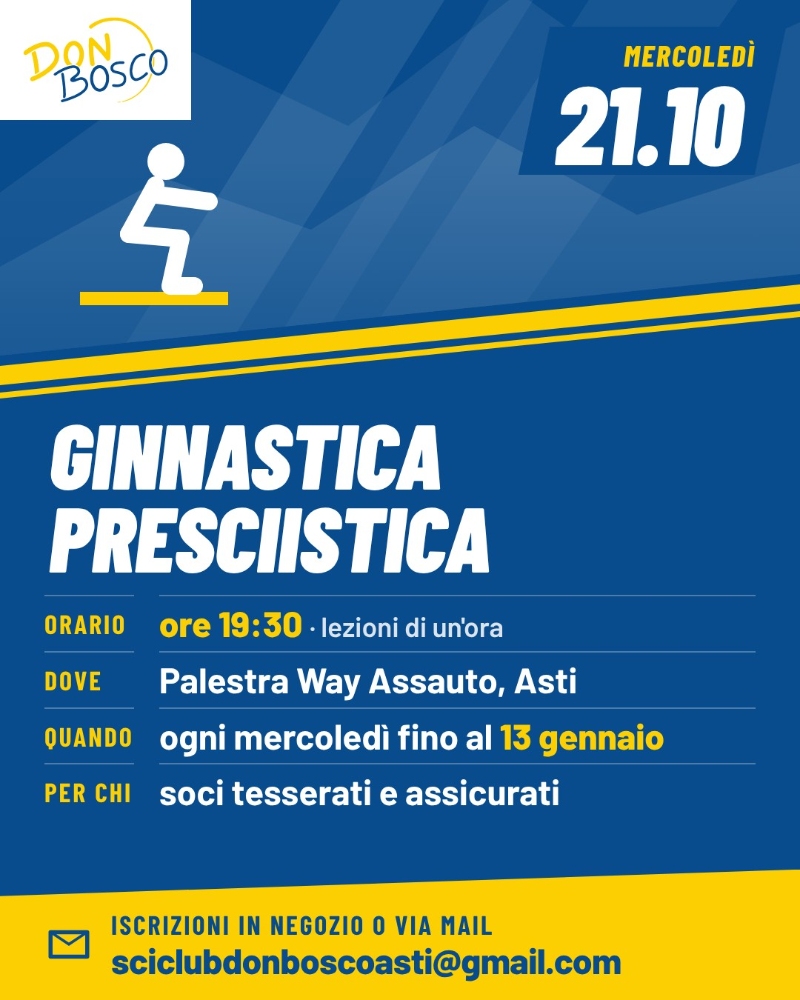 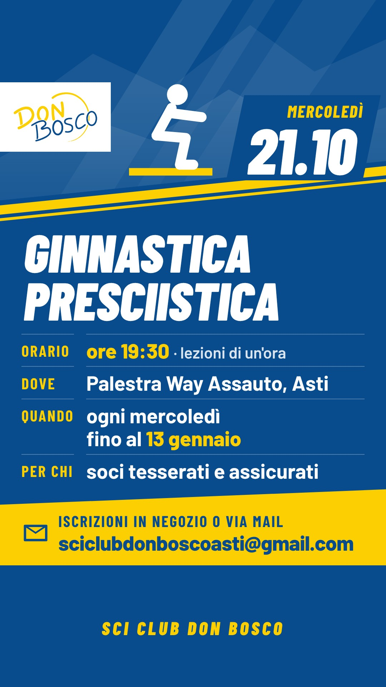

Rifatta l'11/10: la prima versione aveva diagonali, riquadri inclinati e titoli in
corsivo, che nella linea da gara di Head (Worldcup Rebels) non ci sono. Lì le
scritte sono nere e dritte, e il colore della linea da gara è lo Speed Blue,
vicino al blu del club.

- Sempre il **blu pieno** del club; il giallo solo negli accenti. **Tutto dritto:**
  niente diagonali, niente corsivo, angoli vivi.
- La foto in alto tagliata dritta, chiusa da un **filo giallo** a tutta larghezza.
  Senza foto (il corso), il blu con linee di velocità orizzontali e la figura
  dell'esercizio in bianco.
- Sopra il titolo la riga gialla spaziata che dice cos'è; il **titolo** in Barlow
  nero (800) maiuscolo, bianco, 104 px, sempre alto due righe.
- La **scheda**: tre caselle dritte coi dati principali, come la scheda tecnica di
  uno sci: etichetta gialla in Barlow Condensed 34, numero bianco in Barlow nero 78
  (giorno e data `17.01`, ora o partenza, quota soci; per il corso la durata).
- Sotto, il resto dei dati su righe con un filo sottile: etichette maiuscole 34,
  valori 46; orari, prezzi e scadenze in giallo.
- Le **iscrizioni** nella fascia gialla dritta in fondo.
- Nel calendario niente scheda: le gite partono subito sotto il titolo, col giorno
  nel colore della gita (domenica gialla, sabato bianca).

### E · Fascia (stile classico, alla Rossignol)

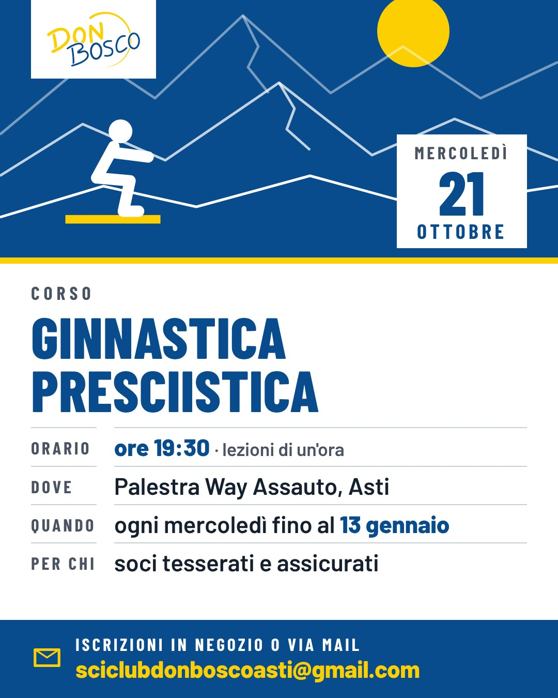 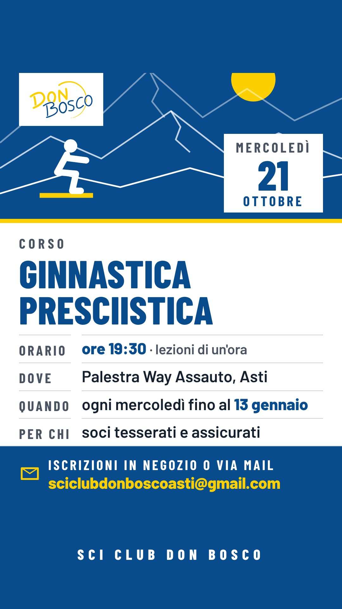

- Il **bianco** come fondo e tanto spazio vuoto; la foto grande ad angoli vivi e
  sotto la **doppia fascia** blu (spessa) e gialla (sottile), a tutta larghezza.
- La **data** in un riquadro bianco appoggiato sul bordo della foto: giorno, numero
  grande, mese.
- Sopra il titolo una **riga spaziata** che dice cos'è ("Corso", "Gita sociale",
  "Serata del club", "Le gite del mese"): nel generatore andrebbe presa dalla categoria.
- Il **titolo** in Barlow Condensed dritto (800), maiuscolo, blu, 112 px, sempre alto
  due righe. Dati con fili sottili: etichette grigie maiuscole 34, valori 46;
  orari, prezzi e scadenze in blu.
- Le **iscrizioni** nella fascia blu in fondo, la mail in giallo (contrasto 5,8:1).
- Senza foto (il corso), montagne disegnate a linee bianche sul blu, il sole giallo
  e la figura dell'esercizio.

### F · Diagonale (alla Ski Club of Great Britain)

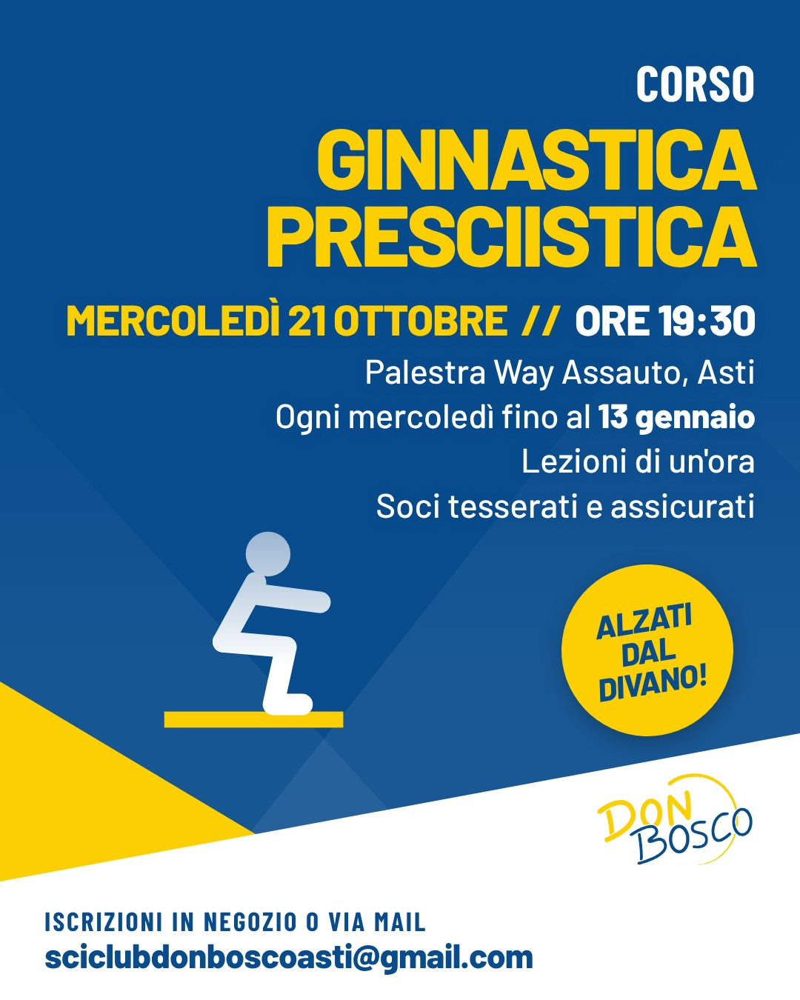 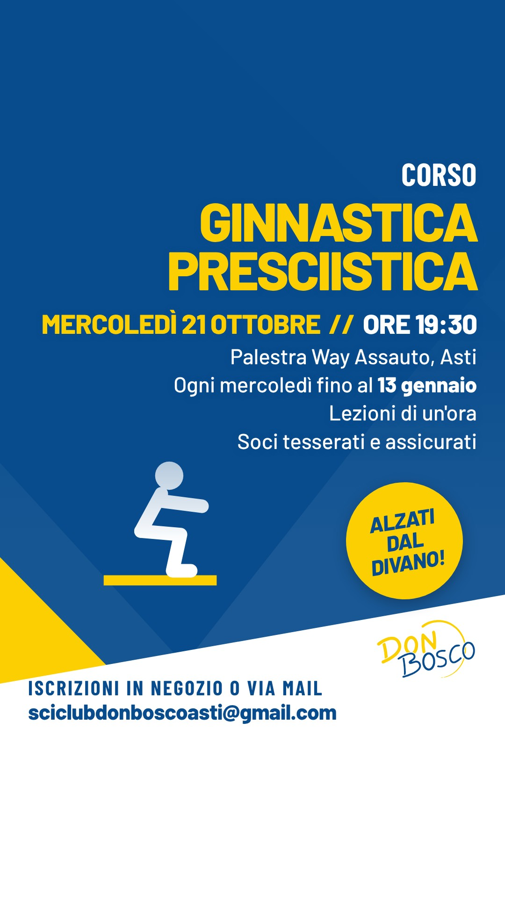

Rifatta l'11/10: la prima versione (dati in un grande blocco blu con le etichette)
sembrava vecchia. Questa segue da vicino gli esempi del loro Instagram.

- La **foto a tutta pagina** e il **testo scritto sopra, allineato a destra**, su un
  velo blu che sfuma verso il basso e lascia la foto libera nella parte centrale.
- **Tre livelli di testo**, come nei loro post: la riga alta e stretta che dice
  cos'è (Barlow Condensed 68, bianca), il **titolo enorme giallo** (Barlow nero 116,
  spaziatura stretta, sempre alto due righe), poi data e dati.
- La **data in giallo** (Barlow maiuscolo 58) con l'ora sulla stessa riga, in bianco
  dopo le barre: `SABATO 10 APRILE // ORE 20:00`, come il loro
  `SAVE THE DATE // 21/10/26`.
- I **dati in righe brevi**, senza etichette in colonna né fili: Barlow 46, normale
  per le parole e nero per orari, prezzi e scadenze; le barre gialle `//` solo fra
  due dati che stanno sulla stessa riga. Una riga sola per dato, mai a capo.
- In basso il **piano bianco in diagonale** col logo (le regole del marchio lo
  vogliono su bianco) e le iscrizioni con la mail; sotto sporge un **triangolo
  giallo**, come i piani sovrapposti dei loro post. Il piano bianco può portare
  anche i loghi degli sponsor, come nel loro post con gli sponsor.
- L'**adesivo tondo giallo**, inclinato, porta il **gancio** del post (lo stesso di
  C: "Tutti in pista!", "Si chiude in festa!", "Alzati dal divano!"); senza gancio
  non c'è. Sta sempre nello stesso punto, sotto il testo.
- Il corsivo di Barlow (600 e 800, per il sottotitolo e l'adesivo) è in
  `grafica/font/barlow/`, accanto agli altri pesi.
- Nel calendario le righe sono allineate a destra: la meta, "+ corso" in giallo e
  il giorno nel colore della gita.
- Senza foto (il corso): il blu con piani bianchi trasparenti in diagonale e la
  figura dell'esercizio.
- **Da tenere d'occhio:** il testo sta sulla foto, quindi il velo deve essere
  scuro abbastanza anche con foto chiare (neve al sole); con le prove del
  generatore va controllato su foto vere. I dati non possono essere più di quattro
  righe, altrimenti arrivano all'adesivo.

---

## Le idee da gara (G, H, I)

Richiesta dell'11/10: qualcosa di più moderno e "race", con le immagini di sfondo a
tutto schermo, un po' scurite, le scritte sopra e i contenuti in blocchi dei colori
del club. Tre idee diverse sulla stessa base, tutte dritte (niente diagonali né
corsivo), con le scritte in Barlow e Barlow Condensed neri e maiuscoli. Per ora
solo i post 4:5: la story del corso si fa per l'idea scelta. Stessi testi e foto
delle altre proposte; `rendi.sh verifica` passa (corpi, tagli, fuori tela).

Senza foto (il corso) lo sfondo è il blu del club con le linee di velocità
orizzontali; queste idee però rendono con le foto vere, meglio se con le persone.

### G · Cronometro (le grafiche TV della Coppa del Mondo)

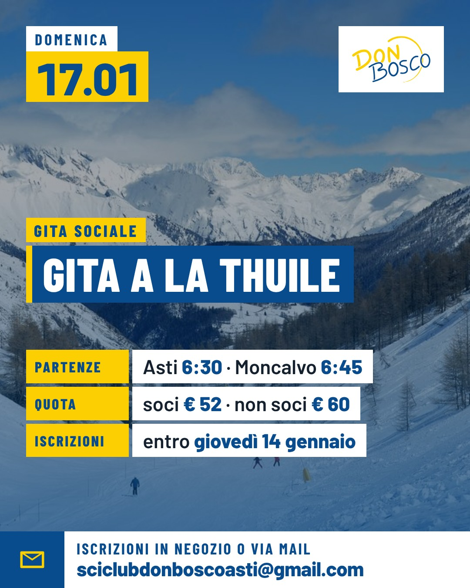 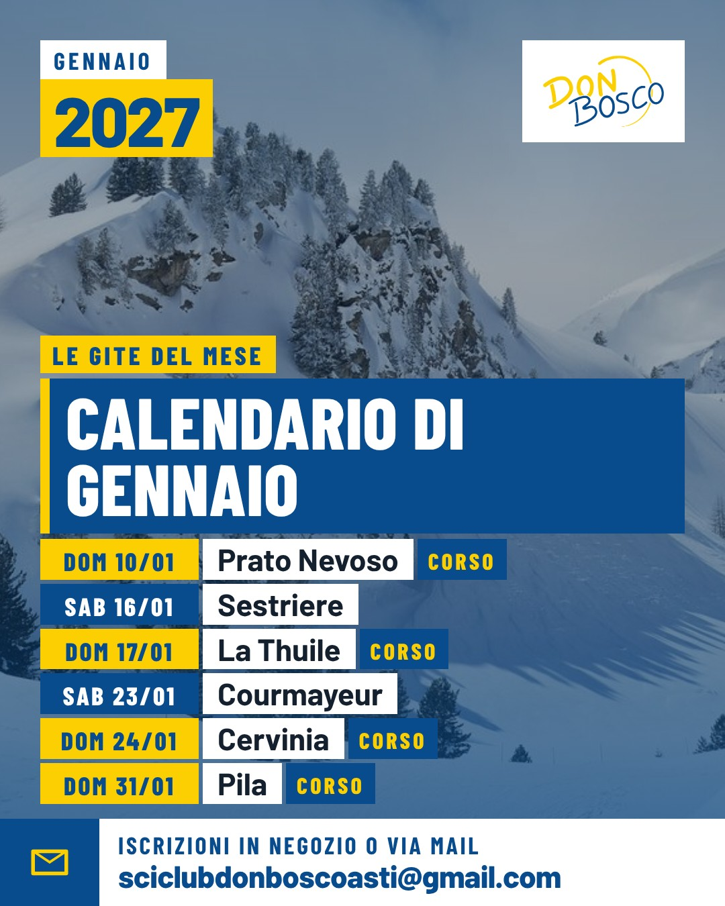

- La foto a tutto schermo **scurita** (e un velo blu più forte in fondo).
- In alto a sinistra la **data come il cronometro**: blocco bianco col giorno,
  blocco giallo con la data grande (`17.01`, Barlow nero 104), blocco bianco con
  l'ora se c'è. In alto a destra il logo su bianco.
- Da un punto fisso a metà post: l'**etichetta gialla** che dice cos'è, il
  **titolo nel blocco blu** col filo giallo a sinistra (Barlow Condensed nero 108,
  spazio sempre alto due righe), poi le **righe come le barre della classifica**:
  etichetta gialla larga uguale per tutte, valore nel blocco bianco largo quanto il
  testo (46, orari e prezzi in blu nero). Fra un blocco e l'altro si vede la foto.
- Il **calendario come la lista di partenza**: giorno nel colore della gita, meta
  nel blocco bianco, "Corso" nel blocchetto blu.
- In fondo il **sottopancia** bianco a tutta larghezza con le iscrizioni e la mail,
  la busta gialla nel blocco blu.

### H · Eco (manifesto sportivo)

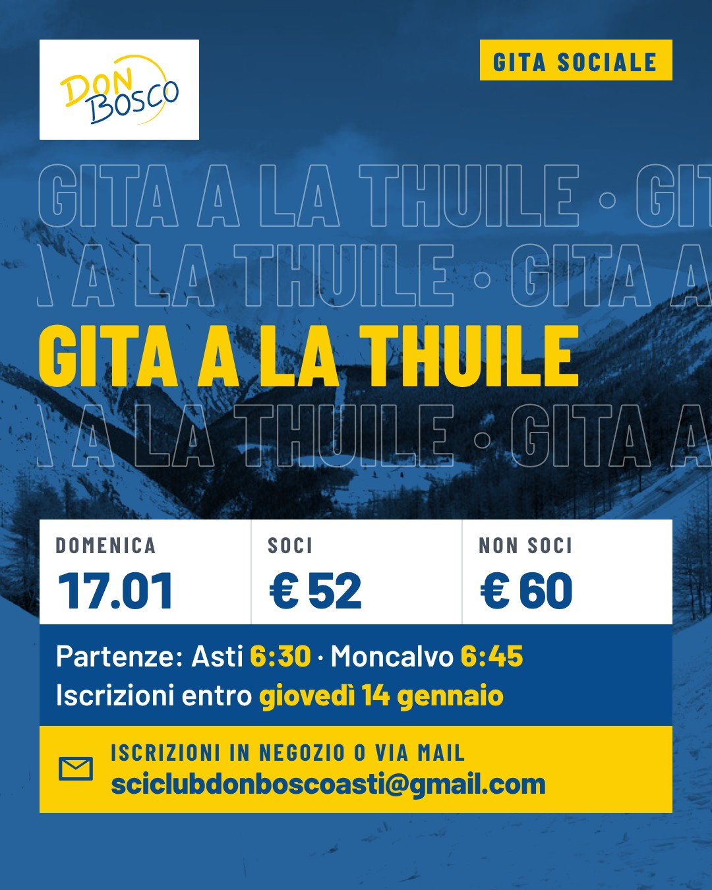 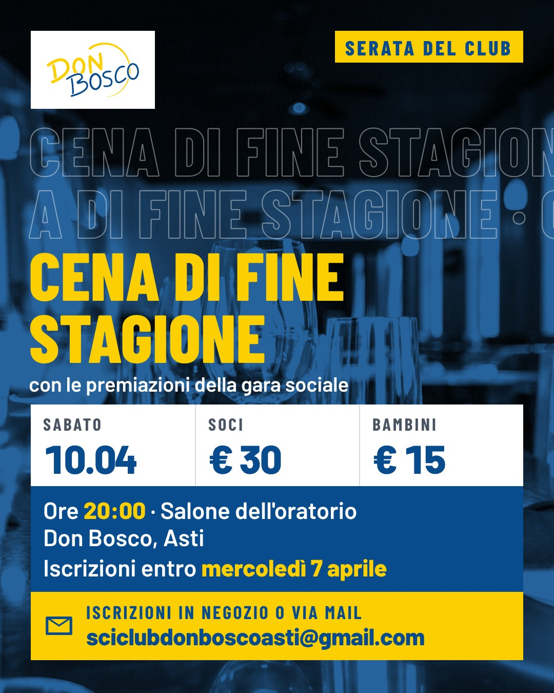

- La foto a tutto schermo in **bicromia**: bianco e nero tinto col blu del club,
  che la scurisce e tiene insieme foto diverse.
- Il **titolo giallo** pieno (Barlow Condensed nero 132) in mezzo a **copie solo
  contornate** che fanno da eco, sfalsate e tagliate dal bordo: due righe sopra e,
  se il titolo sta in una riga, una sotto. Le copie sono solo decorazione.
- In alto il logo su bianco e l'etichetta gialla.
- In basso, da un punto fisso, **tre blocchi pieni uno sull'altro**: la scheda
  bianca coi numeri grandi (data e prezzi, 78), il blocco blu coi dettagli (46,
  orari e scadenze in giallo), la fascia gialla delle iscrizioni.
- Nel calendario le gite stanno in righe nel blocco bianco, al posto della scheda.

### I · Bento (griglia di tessere)

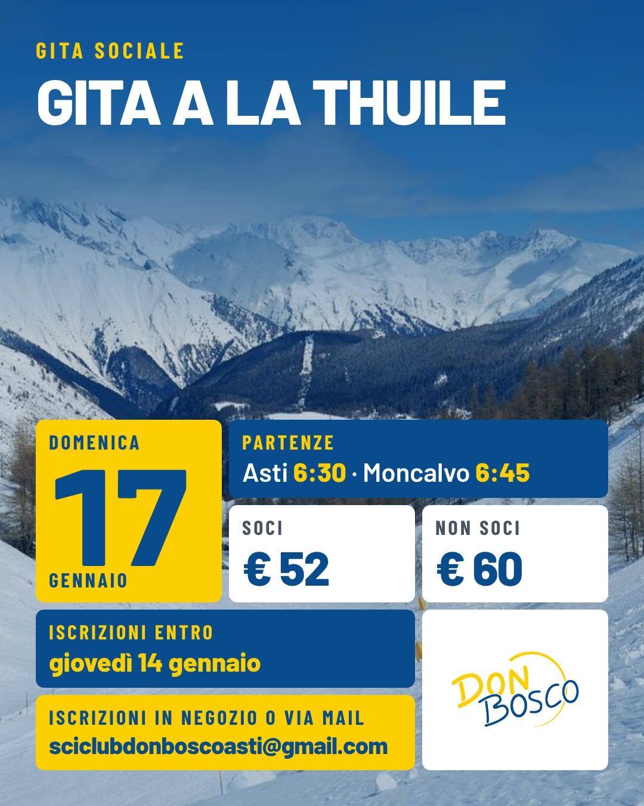 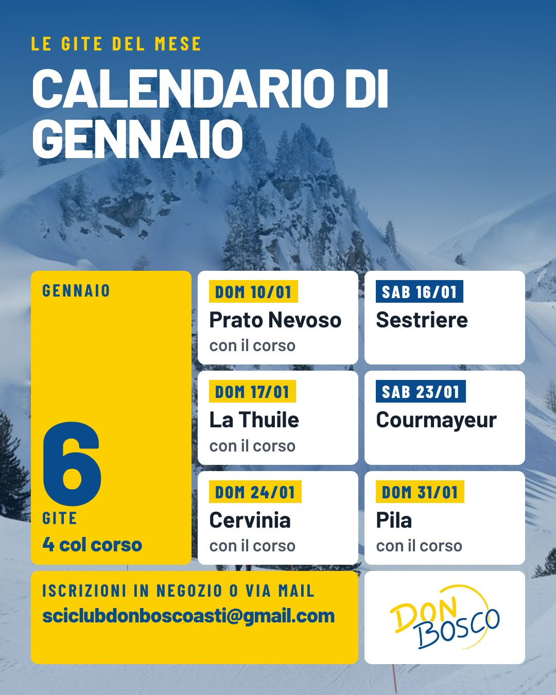

- La foto a tutto schermo con un **velo blu forte in alto**, dove sta il titolo
  bianco (Barlow nero 106), e leggero sotto.
- In fondo una **griglia di tessere** dritte, una per dato, coi numeri grandi: la
  data nella **tessera gialla alta** (il giorno enorme, 230), prezzi e orari nelle
  bianche (80), i dati con più parole nelle blu (44), il logo nella sua tessera
  bianca, le iscrizioni nella gialla. Fra una tessera e l'altra si vede la foto.
- La griglia è appoggiata al fondo; la disposizione delle tessere cambia col tipo
  di post (`grid-template-areas` nella pagina). Senza foto le tessere blu
  diventano bianche, se no sul fondo blu non si vedrebbero.
- Nel calendario una tessera per gita, col giorno nel colore della gita; la
  tessera gialla conta le gite del mese.

**Da decidere:** quale proposta (D–I, o nessuna) portare nel generatore, accanto a
Ritocco, Montagna, Biglietto, Calendario e Divano. Per G, H e I servono foto buone:
sono la metà del post.
