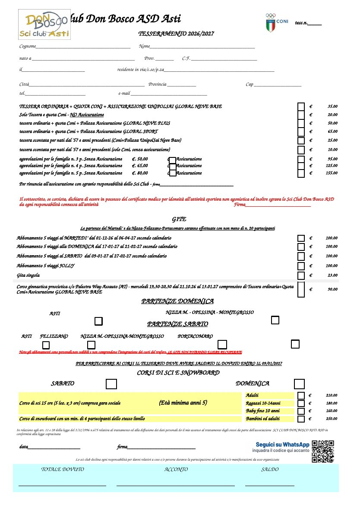
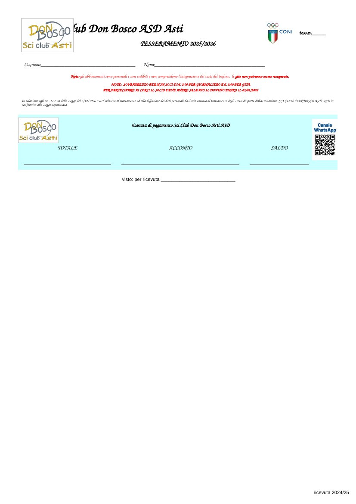

# Scheda di tesseramento 2026/2027 col QR del canale WhatsApp

Proposta: la scheda e la ricevuta di sempre, con il QR del canale WhatsApp
nello spazio che era vuoto. Nient'altro cambia: righe, colonne, celle unite e
testi sono quelli dell'originale (`legacy/dati26/1TESSERAMENTO Scheda e
Ricevuta.xlsx`). Controllato confrontando pixel per pixel il PDF nuovo con
quello originale: diversa solo la zona del QR (più quattro pixel del logo CONI,
per la compressione dell'immagine).

 

| File | Cosa |
|---|---|
| `scheda-con-qr.pdf` | la scheda, una pagina, da stampare |
| `ricevuta-con-qr.pdf` | la ricevuta |
| `tesseramento-con-qr.xlsx` | il file da usare al posto del vecchio: **solo in locale**, non su GitHub |

- **Scheda:** in basso a destra, fra l'informativa e la casella dei totali: il
  QR nella colonna M e "Seguici su WhatsApp · inquadra il codice qui accanto"
  sopra l'avvertenza "Lo sci-club declina...". QR di 14 mm in stampa,
  leggibile da vicino.
- **Ricevuta:** sotto la casella azzurra non c'è posto senza alzare le righe;
  dentro, a destra di SALDO, sì: un riquadro bianco con "Canale WhatsApp" e
  il QR (14 mm in stampa). È il foglio che il socio si porta a casa.
- La ricevuta dice ancora **TESSERAMENTO 2025/2026** e "saldato entro il
  05/01/2026": è così anche nell'originale, da aggiornare a mano.

Perché l'xlsx non è su GitHub: oltre al modulo contiene il regolamento e
l'informativa privacy, con l'IBAN e il domicilio del presidente, e il suo nome
nelle proprietà del file; il repository è pubblico e `.gitignore` esclude
tutti gli `.xlsx`. I PDF invece hanno solo la pagina stampata e le proprietà
del file senza autore.

## Sorgenti

In `sorgenti/`: `etichetta.html` (la scritta e il riquadro della ricevuta),
`metti-qr.py`, che mette le immagini nell'xlsx lavorando sull'XML (openpyxl
perderebbe i quadratini disegnati della scheda), e `rendi.sh`, che rifà
tutto dall'originale in `legacy/dati26/` con Chrome e LibreOffice:

    ./sorgenti/rendi.sh

Il QR (`qr-modulo.png`, versione 3-L: moduli grandi per una stampa piccola)
e il cartello per il negozio sono in [`../canale-whatsapp/`](../canale-whatsapp/).
