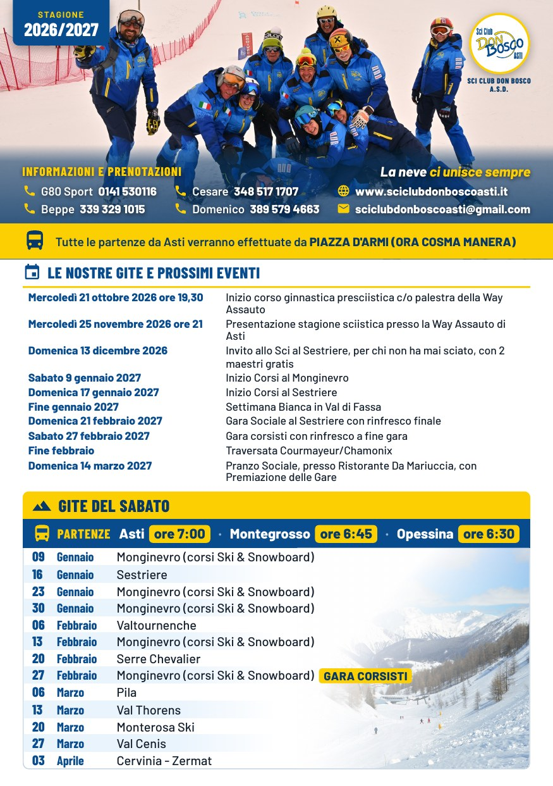
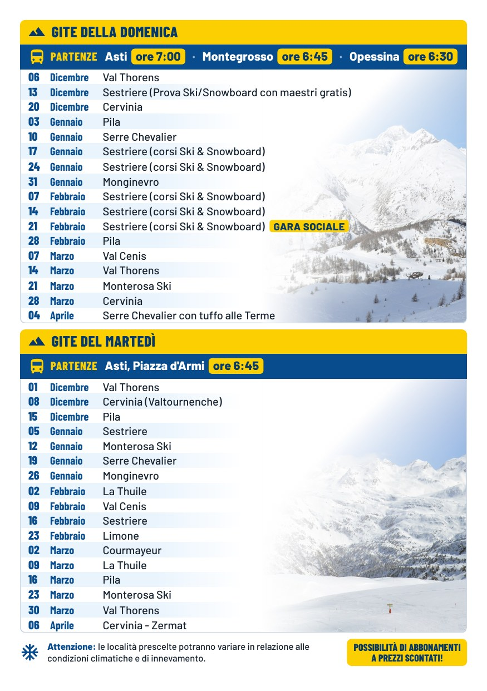

# Volantino 2026/2027, A5 fronte-retro

Rifatto il 15/10/2026 al posto di `Volantino_Sci_Club_Don_Bosco_A5_Fronte_Retro.pdf` (immagine
fatta con l'IA, logo sbagliato, testo non selezionabile), con gli stessi contenuti, il logo
ufficiale tondo e i colori e i caratteri del club (blu `#084C8D`, giallo `#FCCF02`, Barlow).

 

| File | Per |
|---|---|
| `volantino-2026-2027.pdf` | A5 (148×210 mm), due pagine: stampa in casa fronte-retro (lato lungo), invio via mail |
| `volantino-2026-2027-tipografia.pdf` | 154×216 mm: 3 mm di abbondanza per lato, da dare alla tipografia (si rifila ad A5) |
| `volantino-2026-2027-fronte.jpg`, `-retro.jpg` | anteprime, anche da mandare su WhatsApp |

- **Fronte:** la foto del gruppo intera (il ritaglio di `FOTO COPERTINA_mod.JPG`, portato un po' più
  su), il cartellino della stagione, il logo tondo a destra sulla neve con «Sci Club Don Bosco A.S.D.»;
  sopra la parte bassa della foto, su un velo blu, informazioni e prenotazioni e «La neve ci unisce
  sempre»; la fascia gialla di Piazza d'Armi (ora Cosma Manera), i prossimi eventi e le gite del sabato.
- **Retro:** le gite della domenica e del martedì, l'avvertenza sulle località e gli abbonamenti.
- Le gite in colonna, una per riga (data, mese, località a ~10 pt), con fasce azzurrine alterne che
  sfumano nel bianco prima della foto; per ogni giorno una barra blu con le **partenze**: luogo in
  grassetto e ora in giallo. «GARA SOCIALE» e «GARA CORSISTI» su cartellino giallo. A destra di ogni
  gita una montagna alta quanto il riquadro, sfumata a 45° verso il testo.
- **Nessuna trasparenza nel PDF:** sfumature delle foto e velo della copertina sono fusi dentro i JPEG
  (`sorgenti/sfuma.py`), le fasce sfumano nel bianco pieno. Con le trasparenze CSS alcuni lettori PDF
  mostravano le foto senza sfumatura e le fasce grigio scuro.
- Testi vivi e caratteri incorporati: il PDF si legge, si cerca e si stampa nitido.
- Corretti rispetto all'originale: «Mercoledì» con l'accento, «presciistica», «le località
  prescelte» (era «prescelto»). Da far controllare a chi lo scrive: le partenze del **sabato**
  (Asti 7:00, Montegrosso 6:45, Opessina 6:30) sono uguali a quelle della domenica anche
  nell'originale, e «Cervinia - Zermat» (non «Zermatt»).

## Sorgenti

`sorgenti/volantino.html`: i dati (telefoni, eventi, gite) sono in elenchi in fondo alla pagina;
per un anno nuovo si cambiano lì. `sorgenti/rendi.sh` lancia `sfuma.py` (foto ritagliate e sfumate
in `sorgenti/foto/`), poi rifà PDF e anteprime con Chrome e si ferma se qualcosa finisce a meno di
4 mm dal bordo o se resta una striscia bianca sul bordo destro. Se cambia l'altezza degli elenchi delle
gite, vanno aggiornate le misure delle colonne in `sfuma.py`.

Foto: `FOTO COPERTINA.JPG` (del club); `monte-bianco.jpg`, `paramont.jpg` e `pista-san-bernardo.jpg`
in `sorgenti/foto/` sono di DimiTalen, Wikimedia Commons, **CC0** (La Thuile, 2024): libere, senza
obbligo di citarle.
